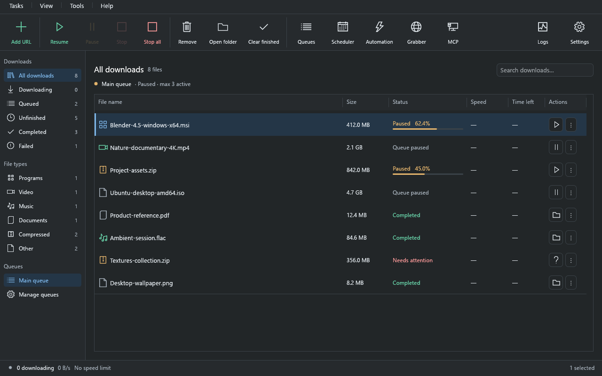

<p align="center">
  
</p>

<h1 align="center">Download Engine</h1>

<p align="center">
  <strong>Download files and videos. Organize your queues. Automate the routine.</strong><br>
  A native Windows download manager built in Rust, with browser integration and local automation.
</p>

<p align="center">
  <a href="#install">Install</a> ·
  <a href="#supported-video-sites-and-formats">Video support</a> ·
  <a href="#quick-start">Quick start</a> ·
  <a href="docs/user-guide.md">User guide</a> ·
  <a href="SECURITY.md">Security</a> ·
  <a href="CHANGELOG.md">Changelog</a>
</p>

<p align="center">
  <strong>Windows x64</strong> · Installer or portable · Chrome, Edge, Brave &amp; Firefox · MIT licensed
</p>



<p align="center"><em>Example desktop layout in dark mode, with sample downloads.</em></p>

## What is Download Engine?

Download Engine brings file transfers, supported video downloads, schedules, and
browser handoffs into one desktop app. Add a link, review where it will be saved,
and manage progress from a download list with queues and individual status windows.
Use it interactively, run a portable copy, or connect your own scripts and AI client.

The familiar layout is inspired by **Internet Download Manager (IDM)**. Download
Engine is an independent project, is not affiliated with IDM, and does not claim
complete IDM feature parity.

## Features

### File downloads and recovery

- Download over **HTTP, HTTPS, FTP, and FTPS**, with parallel connections where
  supported by the server.
- Pause and resume transfers, retry temporary failures, and recover unfinished
  downloads after restarting the app. Resume depends on the server and file remaining compatible.
- Replace an expired link or use browser-assisted recovery while checking whether
  existing downloaded data can be reused.
- Add individual links, import batches, organize files into categories and folders,
  and export download lists.
- Set global and per-file speed limits, hourly/daily data quotas, and per-site
  connection settings. Use proxies or supported site authentication when needed.

### Queues and scheduling

- Group downloads into named queues with their own order and concurrency limits.
- Schedule a one-time start or recurring daily/weekday download windows.
- Use synchronization queues to check supported files for changes.
- Configure completion notifications and optional actions such as exiting the app,
  shutting down, sleeping, or hibernating the computer.

### Browser and website tools

- Send links from **Chrome, Edge, Brave, and Firefox**, capture matching file
  downloads, or select links from the current page.
- Discover supported media through the extension and review video quality before
  adding a download.
- Opt into a reviewed browser-login handoff for compatible authenticated direct
  file downloads; ordinary capture does not copy your browser cookies.
- Find files with the website grabber, save and schedule grabber projects, or
  capture supported static pages and their assets for offline viewing.
- Preview the contents of supported ZIP archives before downloading the whole file.

### Desktop controls and automation

- Switch between light and dark themes, customize the download table, and keep
  transfers running in the system tray.
- Choose from **19 interface languages**, with Windows language detection and
  English fallback; read the bundled guide offline with **F1**.
- Verify SHA-256 checksums and optionally scan files with a configured antivirus.
- Build routing rules, write **Lua or PowerShell** scripts in the editor, or
  control the app through its **CLI** and optional local **MCP server**.

## Supported video sites and formats

Download Engine includes built-in readers for **YouTube, TikTok, Bilibili, and
Twitch**, plus supported HLS and DASH streams from other sites. Paste a supported
video page into **Add URL**, open **Tools → Preview video**, or use the extension's
**Download video** / **Find videos on this page** actions. Review the available
quality and audio choices, then select **Add video to queue**.

| Site or format | Supported workflow | Main limitations |
| --- | --- | --- |
| **[YouTube](docs/reference.md#youtube-video-downloads)** | Public, finished videos when YouTube returns a supported HLS response; quality/audio selection and MP4 merging. | No sign-in/private/age-restricted videos, playlists, subtitles, live recording, or JavaScript/proof-of-origin challenges. This is not full yt-dlp compatibility. |
| **[TikTok](docs/reference.md#tiktok-video-downloads)** | Public video pages with available MP4 qualities, including audio; resumable file downloads. | No private or sign-in-only videos, photo posts, live videos, or `vm.tiktok.com` short links. Browser challenges can prevent extraction. |
| **[Bilibili](docs/reference.md#bilibili-video-downloads)** | Public `BV`/`av` video pages and a selected part of a multi-part video; DASH video/audio selection and merging. | Anonymous access currently offers up to 480p. Sign-in qualities, paid/region-locked/DRM videos, live pages, and `b23.tv` short links are unsupported. |
| **[Bilibili Bangumi](docs/reference.md#bilibili-video-downloads)** | Accessible episode links; a season link selects its first main episode. | Members-only previews, region restrictions, and DRM are rejected. This does not download an entire season at once. |
| **[Twitch](docs/reference.md#twitch-video-downloads)** | Public past broadcasts, highlights, and uploads, with available HLS qualities. | No live channels, clips, subscriber-only videos, or sign-in support. |
| **[HLS](docs/reference.md#hls-video-downloads)** | Supported finished, unencrypted `.m3u8` streams, with quality/audio selection and supported track merging. | No live recording, encrypted streams, or DRM. Container and playlist limits apply. |
| **[DASH](docs/reference.md#dash-video-downloads)** | Static, single-period, unencrypted MP4 video/audio in supported `.mpd` manifests, merged without re-encoding. | No dynamic/live or encrypted streams, multiple periods, WebM representations, or subtitles. |
| **[Custom sites](docs/automation.md#site-readers)** | Add a Lua site reader that resolves a page into supported direct files or streams. | Public internet and Direct connection only; no browser-login cookies. Readers cannot bypass the engine's media restrictions. |

Available qualities depend on each site's response. Website changes, region
restrictions, and access challenges can make an otherwise supported link fail.
Unsupported responses report an error rather than silently saving the video page
as a media file. Download only content you are authorized to save.

## Install

Choose a **Windows x64** package from the project's release assets. The desktop app
is required for browser integration; the extension does not download on its own.

| Package | How to use it |
| --- | --- |
| `DownloadEngine-<version>-UnsignedSetup.exe` | Install for your Windows account; no administrator access needed. |
| `DownloadEngine-<version>-Unsigned-windows-x64.zip` | Extract the entire archive into a writable folder and run `de.exe`. Keep its supporting files together. |

Current Windows packages are **unsigned**. They do not have a verified Authenticode
publisher signature, and Windows may show an unknown-publisher warning. Check the
source of the package and compare its SHA-256 hash with the release's
`SHA256SUMS-<version>` file. A matching hash confirms that the bytes match the
published checksum; it does not establish publisher identity or guarantee safety.

### Upgrade an existing copy

Close Download Engine through **Tasks → Exit** before upgrading. Stop a separately
started CLI MCP server as well. Use the installer to upgrade an installed copy,
or update the same portable folder while preserving its `data` and downloads.
Keep the application and extension versions aligned.

**Upgrading to 3.0:** the Firefox extension now has the identity
`download-engine@xetro`. Finish any pending browser handoffs, remove the old
developer-loaded extension, and install the new one, then reconnect it through
**Tools → Browser setup**. Firefox treats it as
a different extension, so its settings start fresh; your desktop queues, downloads,
and profile stay in place. Reload developer-loaded Chromium extensions after
replacing their files. See the [browser setup guide](docs/reference.md#connect-a-browser).

There is no automatic updater. Windows is the supported desktop platform;
macOS, Linux, and Android packages are not provided by this release workflow.

## Quick start

1. Run `de.exe` and select **Add URL**.
2. Paste a direct file link, choose a queue and destination, then select
   **Start download**. For a supported video page, review the quality choices first.
3. Watch progress in the download list; double-click an entry for its status window.
4. Use **Tasks → Add batch** for multiple file links, or create a queue for a
   group you want to schedule together.

Open **Preferences** to adjust appearance, folders, connections, scanning, and tray
behavior. Change the interface language under **Appearance → Language**, then
select **Save**. Open **Help → Guide** or press **F1** for the offline walkthrough.

## Browser integration

> **Browser-store approval is pending.** For now, the extension must be loaded
> manually. Chrome, Edge, and Brave require **Developer mode** and **Load unpacked**.
> Firefox uses **Load Temporary Add-on** instead and requires reloading the add-on
> after every browser restart. Official store links will be added after approval.

Open **Tools → Browser setup**, select your browser, and follow its connection
steps. The desktop communicates with the extension through a registered native
messaging host. Select **Check connection** in the extension popup to verify setup.

| Browser | Setup and requirements |
| --- | --- |
| **Chrome, Edge, Brave** | Enable **Developer mode** on the browser's extensions page, choose **Load unpacked**, and select the folder shown by **Open extension folder** in Download Engine. Then follow the [Chromium connection steps](docs/reference.md#chrome-edge-and-brave). The Chromium manifest requires version 128 or newer of the underlying browser engine. Brave has its own desktop connection registration. |
| **Firefox** | Choose **Load Temporary Add-on** on the debugging page shown by Browser setup, then select `manifest.json` from **Open extension folder**. Follow the [Firefox connection steps](docs/reference.md#firefox). The extension requires **Firefox 142 or newer**; Firefox/ESR 140 and Firefox 141 are unsupported. |

Keep Developer mode enabled while using the unpacked Chromium extension. Firefox's
temporary add-on is removed when Firefox restarts; permanent installation requires
Mozilla signing. The supplied extension ZIPs do not install themselves as approved
store extensions.

**Capture file downloads** and **Detect media while browsing** default to on once
installation permissions are accepted. Existing off choices and capture filters
are preserved when the extension identity stays the same; the Firefox 3.0 identity
change described above starts with fresh extension settings. You can disable either
feature in the extension. Video detection does not start a video download: you still
choose an item and review it. If a file handoff fails, the extension attempts to
resume the browser download and reports the failure; check the browser's Downloads
list if it remains paused.

**Browser-login access is separate and optional.** A reviewed, supported direct
file handoff can copy matching cookies for that download after permission is
granted. It does not add account access to the built-in video readers. See
[browser-login behavior](docs/reference.md#downloads-using-your-browser-login) and
the [security policy](SECURITY.md#browser-permissions-and-native-messaging).

## Automation and AI clients

Choose the level of automation you need:

| Interface | Use it for |
| --- | --- |
| **Routing rules** | Send new files to a queue by site/file type, set a speed limit, or start another queue after completion. |
| **Lua scripting** | Inspect queues, perform supported app actions, and react to download events using the built-in Lua runtime. |
| **PowerShell scripting** | Run trusted Windows automation under your own account. This has normal file and program access. |
| **Lua site readers** | Extend video-page support through a separate, restricted page-fetching API. |
| **`de-cli.exe`** | Inspect and manage downloads from a terminal or existing script, with structured JSON results. |
| **Local MCP** | Let a compatible AI client inspect or control this app through an authenticated Streamable HTTP connection. |

For a first look at the CLI, open PowerShell beside `de.exe` and run:

```powershell
.\de-cli.exe --help
.\de-cli.exe list
.\de-cli.exe queues
```

Open **MCP** in the app and start with **View only** if your AI client only needs
to inspect state. The desktop server starts disabled. For an explicitly read-only
terminal server, use `de-cli.exe mcp --read-only`; plain `de-cli.exe mcp` allows
changes. Keep its access token private. See the [MCP setup guide](docs/mcp.md) and
[AI usage guide](docs/mcp-ai-guide.md) before connecting a client.

The scripting editor includes syntax checks, line numbers, highlighting, and
autocomplete. Read the [automation reference](docs/automation.md) for script
permissions, events, timeouts, cancellation, and CLI examples.

## Data and security

Installed profiles normally live in `%LOCALAPPDATA%\Download Engine`; profiles
created before the rename may keep `%LOCALAPPDATA%\IDM_EX`. Portable copies use
their own `data` folder. `DOWNLOAD_ENGINE_HOME` selects a separate profile, and the
legacy `IDM_EX_HOME` variable remains supported.

The queue database is **not encrypted** and can contain signed URLs and local file
paths. Supported credentials and browser-login snapshots use Windows credential
storage or user-scoped DPAPI, but other programs running as your Windows account
are outside that protection boundary. Review scripts before running them, keep
MCP local, and treat downloaded files and offline websites as untrusted content.

See [SECURITY.md](SECURITY.md) for private vulnerability reporting, browser
permissions, data protection, and the limits of these controls.

## Guides

| Topic | Documentation |
| --- | --- |
| Everyday use, recovery, and troubleshooting | [User guide](docs/user-guide.md) |
| Supported sites, streams, and protocol limits | [Detailed reference](docs/reference.md#youtube-video-downloads) |
| CLI, rules, and custom scripts | [Automation](docs/automation.md) · [Lua walkthrough](docs/user-guide.md#lua-scripting) |
| Connect an AI client | [MCP setup](docs/mcp.md) · [AI usage guide](docs/mcp-ai-guide.md) |
| Language settings | [Languages](docs/localization.md) |
| Detailed behavior, limits, and development checks | [Reference](docs/reference.md) |
| Report a vulnerability and understand security boundaries | [Security policy](SECURITY.md) |
| Release history | [Changelog](CHANGELOG.md) |
| Version, build, and package a release | [Release workflow](docs/releases.md) · [GitHub release guide](docs/github-release.md) |
| Prepare extensions for browser stores | [Browser release guide](docs/browser-release.md) |

## Build from source

Build on Windows with Rust stable and the MSVC target, Visual Studio C++ build
tools, and the Windows SDK (including `rc.exe`):

```powershell
cargo build --release --locked --bins
```

This builds `de.exe`, `de-cli.exe`, and `de-host.exe` under `target/release`.
Node.js is needed for JavaScript tests and packaging tools; Inno Setup is needed
for the installer. Neither is required to run the packaged app.

Video merging needs the pinned FFmpeg helper. Source ZIP users can copy it
from the matching binary release or follow the [FFmpeg build instructions](tools/ffmpeg/source/README.md).
See [build and verification details](docs/reference.md#build-and-verify) and the
[release workflow](docs/releases.md) for the full check and packaging sequence.

## Help and contributions

For a connection problem, expired link, or stalled queue, start with the
[troubleshooting guide](docs/user-guide.md#troubleshooting). When reporting an
ordinary bug, include the app/extension versions, Windows/browser versions, steps
to reproduce, and redacted diagnostics. Use synthetic or public examples instead
of private download URLs, cookies, tokens, or your profile database.

Suspected vulnerabilities should follow the [private reporting process](SECURITY.md#report-a-vulnerability),
not a public issue. For source changes, follow the [release workflow](docs/releases.md)
and run the checks relevant to the behavior you change.

## License

Download Engine's original code is [MIT licensed](LICENSE). Bundled components retain
their own licenses; see [third-party notices](THIRD-PARTY-NOTICES.md), including
FFmpeg's license and corresponding source materials.
