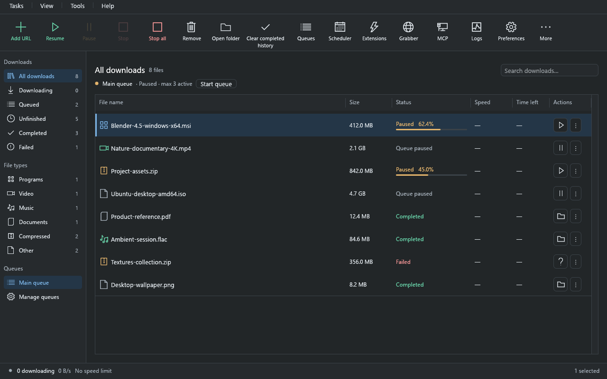
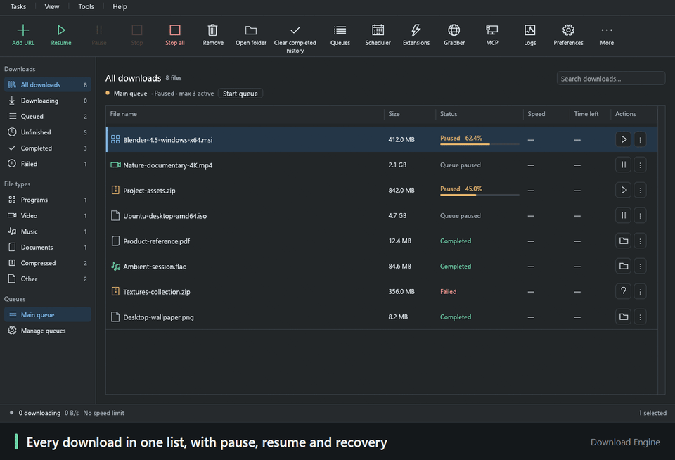

<p align="center">
  
</p>

<h1 align="center">Download Engine</h1>

<p align="center">
  <strong>A free, open-source download manager for Windows, macOS and Linux.</strong><br>
  Download files, videos and torrents, organize your queues and automate the routine. Built in Rust, with browser integration.
</p>

<p align="center">
  <a href="https://jasxtd.github.io/Download-Engine/">Website</a> ·
  <a href="#install">Install</a> ·
  <a href="#supported-video-sites-and-formats">Video support</a> ·
  <a href="#torrent-downloads">Torrents</a> ·
  <a href="#lua-extensions-and-media-providers">Lua extensions</a> ·
  <a href="#quick-start">Quick start</a> ·
  <a href="docs/user-guide.md">User guide</a> ·
  <a href="PRIVACY.md">Privacy</a> ·
  <a href="SECURITY.md">Security</a> ·
  <a href="CHANGELOG.md">Changelog</a>
</p>

<p align="center">
  <strong>Windows · macOS · Linux</strong> · Chrome, Edge, Brave &amp; Firefox · MIT licensed
</p>



<p align="center"><em>Example desktop layout in dark mode, with sample downloads.</em></p>

## What is Download Engine?

Download Engine brings file transfers, supported video downloads, torrents, schedules and
browser handoffs into one desktop app. Add a link, review where it will be saved, and follow
progress in a download list with queues. Windows, macOS and Linux share the same interface and
engine; a few integrations remain Windows-only, as the
[native-platform guide](docs/cross-platform.md) explains.

Looking for a free **IDM alternative**? The familiar layout is inspired by
**Internet Download Manager (IDM)**. Download Engine is an independent project, is
not affiliated with IDM, and does not claim complete IDM feature parity.

Get published packages from the [releases page](https://github.com/JasXTD/Download-Engine/releases)
and read the [changelog](CHANGELOG.md) for release and development notes.

**[Download 3.19.0](https://github.com/JasXTD/Download-Engine/releases/tag/v3.19.0)** —
Windows, Apple Silicon and Intel Macs, and Linux x64. Native FFmpeg is bundled;
browser extensions, source code and SHA-256 checksums are included with the release.

## Features

- **Files:** HTTP, HTTPS, FTP and FTPS, with parallel connections where the server supports them.
  Add batches, import and export lists, and use proxies or site logins.
  [Downloads guide](docs/user-guide.md#downloads--recovery)
- **Recovery:** pause, resume and retry, recover unfinished downloads after a restart, and replace
  an expired link. [Pause and recover](docs/user-guide.md#pause-stop-resume-and-recover)
- **Hosting links:** MEGA public files, public WeTransfer transfers, and exposed file links on
  other download pages. [MEGA](docs/mega.md) · [WeTransfer](docs/wetransfer.md) ·
  [Link discovery](docs/user-guide.md#find-files-on-a-website)
- **Video:** YouTube, TikTok, Bilibili, Twitch and compatible HLS and DASH streams, with a choice of
  quality and audio. [Supported sites](#supported-video-sites-and-formats)
- **Torrents:** v1, v2 and hybrid torrents; optional and off by default. [Torrent downloads](#torrent-downloads)
- **Queues and schedules:** named queues, one-time or recurring schedules, speed limits, data
  quotas and completion actions. [Queues guide](docs/user-guide.md#queues--schedules)
- **Browser:** send links and capture downloads from Chrome, Edge, Brave and Firefox, find media on
  a page, or pick links from it. [Browser integration](#browser-integration)
- **Web Grabber:** find files on a website, save and schedule scans, or save a static website for
  offline viewing. [Offline websites](docs/user-guide.md#offline-websites)
- **Checks:** SHA-256 verification, optional antivirus scans and ZIP contents preview.
  [Antivirus guide](docs/user-guide.md#antivirus-scanning)
- **Automation:** routing rules, Lua and PowerShell scripts, Lua site readers and download
  providers, shareable extensions, a JSON CLI and a local MCP server for AI clients.
  [Automation and AI clients](#automation-and-ai-clients)
- **Your workspace:** system, light, dark or custom themes, a customizable toolbar, 19 interface
  languages and an offline guide on **F1**.
  [Custom themes](docs/user-guide.md#custom-themes) · [Languages](docs/localization.md)
- **Crash reports:** review, copy or export local reports from **Help → Crash reports**. Nothing is
  uploaded automatically. [Diagnostics](docs/user-guide.md#read-diagnostics)



<p align="center"><em>A short tour of the real app and browser extension, with sample data.</em></p>

## Supported video sites and formats

Download Engine includes built-in readers for **YouTube, TikTok, Bilibili, and
Twitch**, plus supported HLS and DASH streams from other sites. Paste a supported
video page into **Add URL**, open **Tools → Preview video**, or use the browser extension's
**Download video** / **Find videos on this page** actions. Review the available
quality and audio choices, then select **Add video to queue**.

| Site or format | Supported workflow | Current built-in limitations |
| --- | --- | --- |
| **[YouTube](docs/reference.md#youtube-video-downloads)** | Public, finished videos when YouTube returns a supported HLS response; quality/audio selection and MP4 merging. | No sign-in/private/age-restricted videos, playlists, subtitles, live recording, or JavaScript/proof-of-origin challenges. This is not full yt-dlp compatibility. |
| **[TikTok](docs/reference.md#tiktok-video-downloads)** | Public video pages with available MP4 qualities, including audio; resumable file downloads. | No private or sign-in-only videos, photo posts, live videos, or `vm.tiktok.com` short links. Browser challenges can prevent extraction. |
| **[Bilibili](docs/reference.md#bilibili-video-downloads)** | Public `BV`/`av` video pages and a selected part of a multi-part video; DASH video/audio selection and merging. | Anonymous access currently offers up to 480p. Sign-in qualities, paid/region-locked/DRM videos, live pages, and `b23.tv` short links are unsupported. |
| **[Bilibili Bangumi](docs/reference.md#bilibili-video-downloads)** | Accessible episode links; a season link selects its first main episode. | No built-in support for members-only previews, region-locked episodes or DRM. This does not download an entire season at once. |
| **[Twitch](docs/reference.md#twitch-video-downloads)** | Public past broadcasts, highlights, and uploads, with available HLS qualities. | No live channels, clips, subscriber-only videos, or sign-in support. |
| **[HLS](docs/reference.md#hls-video-downloads)** | Supported finished, unencrypted `.m3u8` streams, with quality/audio selection and supported track merging. | No live recording, encrypted streams, or DRM. Container and playlist limits apply. |
| **[DASH](docs/reference.md#dash-video-downloads)** | Static, single-period, unencrypted MP4 video/audio in supported `.mpd` manifests, merged without re-encoding. | No dynamic/live or encrypted streams, multiple periods, WebM representations, or subtitles. |
| **[Custom sites](docs/automation.md#site-readers)** | Add a Lua site reader that resolves a page into supported direct files or streams. | Public-address fetching with no inherited browser-login cookies. Reader results use the engine's supported formats; custom byte processing uses [Lua providers](docs/lua-providers.md). |

Available qualities depend on each site's response. Website changes, region
restrictions, and access challenges can make an otherwise supported link fail.
Unsupported responses report an error rather than silently saving the video page
as a media file. These are capabilities of the shipped readers, not additional
[license conditions](#license). Developers can extend the app and its Lua providers.

## Torrent downloads

> **Use torrents at your own risk.** Downloaded files may contain malware, and peers
> can see your IP address. Enabling uploads or seeding shares file data with other
> peers. Antivirus scans cannot guarantee that a file is safe. Torrent support is
> optional; uploading, seeding after completion, incoming connections and UPnP are off by default for new profiles.

- **Formats:** v1, v2 and hybrid `.torrent` files, plus `btih` and full SHA-256 `btmh` magnets.
  V2 pieces use authenticated SHA-256 Merkle trees; hybrid files work with v1 peers too.
- **Open** a torrent file with **Tasks → Open torrent file…**, from your file manager or by dropping
  it on the window, or paste a magnet link into **Add download**. Connected browser extensions send
  clicked magnet links and captured torrent files for review; Windows also offers copied magnets.
- **Off until you turn it on.** The app asks first, then you choose the files to download. The usual
  queue, **Stop** and **Stop all** controls apply. Verified pieces are kept, and existing files are
  never overwritten.
- **Sharing** settings live in **Preferences → Torrents**: uploads, upload limits and DHT. Uploading,
  sharing after completion, incoming connections and UPnP start off. Saved choices are preserved
  when upgrading; data quotas count any enabled uploads. Enabling incoming connections or UPnP
  asks for confirmation, then requires Save. Optional UPnP router setup is available on Windows
  and Linux when incoming connections are on.
- **Peer encryption:** choose Off, Prefer encryption (allows plaintext fallback), or Require
  encryption (refuses plaintext). MSE/PE is a legacy compatibility protocol; it does not hide
  your IP address or authenticate peers.
- **uTP:** allow reliable UDP connections when TCP fails. Incoming connections need their
  separate opt-in. This implementation uses CUBIC, not LEDBAT; UPnP maps TCP only.
- **Web seeds:** download verified pieces from HTTP/HTTPS sources in a `.torrent` file and
  keep those sources for restart recovery. Raw magnet `ws=` parameters are not imported.
- **Limits:** torrents pause while a proxy is enabled, because the app's proxy does not carry
  torrent traffic. Adding torrents through the CLI, scripts or MCP is not supported.

New in **3.19.0**: v2 and hybrid support with file selection, verified recovery and the same
transfer controls. A `btih`-only magnet uses v1; a magnet containing `btmh` requires v2
verification. Peer hash requests have bounded memory, disk work and concurrency.
Hash checks establish file integrity, not safety or privacy.

Added in **3.18.0**: the Peers list shows actual TCP/uTP and encryption status. Optional
**VPN/interface binding** keeps torrent peers, trackers, DHT, web seeds and DNS on one
selected interface address, and stops transfers if it disappears. Configure the address
and DNS server in Preferences → Torrents. [Setup and limitations](docs/user-guide.md#download-torrents).

Peer encryption, uTP and web seeds were added in **3.17.0**. Each starts off; enable them in
**Preferences → Torrents → Transfers**. See the [engine notes](torrent/README.md#optional-transports)
for transport policies and limits.

The [torrent guide](docs/user-guide.md#download-torrents) covers Windows registration, sharing,
antivirus scans and moving completed torrents; macOS and Linux file associations are in the
[native-platform guide](docs/cross-platform.md).

## Install

Choose the package for your computer from the
[releases page](https://github.com/JasXTD/Download-Engine/releases). The desktop app is required
for browser integration; the browser extension does not download on its own.

| Package | How to use it |
| --- | --- |
| `DownloadEngine-<version>-UnsignedSetup.exe` | Install for your Windows account; no administrator access needed. |
| `DownloadEngine-<version>-Unsigned-windows-x64.zip` | Extract the entire archive into a writable folder and run `de.exe`. Keep its supporting files together. |
| `DownloadEngine-<version>-macos-arm64.zip` | Apple Silicon Mac: extract and move `Download Engine.app` to its permanent location. |
| `DownloadEngine-<version>-macos-x64.zip` | Intel Mac: extract and move `Download Engine.app` to its permanent location. |
| `DownloadEngine-<version>-linux-x64.tar.gz` | Linux x64: extract into a permanent folder and run `./de`. Requires glibc 2.36+, OpenSSL 3, desktop libraries and a portal backend. |

- **Windows packages are unsigned**, with no verified Authenticode publisher signature, so Windows
  may warn about an unknown publisher. Check the source of the package and compare its SHA-256 hash
  with the release's `SHA256SUMS-<version>` file. A match confirms the bytes match the published
  checksum; it does not establish publisher identity or guarantee safety.
- **macOS packages are ad-hoc signed, not Apple-notarized.** See
  [how to open them](docs/cross-platform.md#macos) and the
  [Linux runtime and keyring requirements](docs/cross-platform.md#linux).
- Every desktop package includes its native **FFmpeg**, with matching source and license notices.
  There is no Android package.

### Upgrade an existing copy

Close Download Engine through **Tasks → Exit** before upgrading, and stop a separately started CLI
MCP server. Use the installer to upgrade an installed copy, or update the same portable folder while
preserving its `data` and downloads. Keep the application and browser extension versions aligned.
Some upgrades change the profile in a way that older versions refuse, so back up the profile before
going back to an older version. Versions 3.0 and 3.6 need extra steps; see the
[upgrade notes by version](docs/reference.md#upgrade-notes-by-version).

The app checks for updates when it opens; turn this off in **Preferences → Startup & tray** on Windows
(**Preferences → Updates** on macOS/Linux), or
check manually from **Help → Check for updates**. Updates are downloaded and installed manually
from the official GitHub release page.

## Quick start

1. Open Download Engine (`de.exe` on Windows, the `.app` on macOS, or `./de` on Linux) and select **Add URL**.
2. Paste a direct file link, choose a queue and destination, then select
   **Start download**. For a supported video page, review the quality choices first.
3. Watch progress in the download list; double-click an entry for its status window.
4. Use **Tasks → Add batch** for multiple file links, or create a queue for a
   group you want to schedule together.

Open **Preferences** to change the appearance, language, folders and connections, and press **F1**
for the offline guide.

## Browser integration

- **Firefox 142 or newer:** install the approved
  [Download Engine Extension](https://addons.mozilla.org/en-US/firefox/addon/download-engine-extension/)
  from Firefox Add-ons. Firefox keeps it updated.
- **Chrome, Edge and Brave, engine version 128 or newer:** store approval is pending. Until then,
  turn on **Developer mode** on the browser's extensions page, choose **Load unpacked** and select
  the folder that **Open extension folder** shows in Download Engine. Keep Developer mode on.

Then open **Tools → Browser setup**, choose your browser and **Connect browser**, and select
**Check connection** in the extension popup. The [Chromium](docs/reference.md#chrome-edge-and-brave)
and [Firefox](docs/reference.md#firefox) steps have the details. The extension ZIPs on the releases
page are for manual loading; Firefox removes the unsigned Firefox ZIP when it restarts.

**Capture file downloads** and **Detect media while browsing** are on by default once the
extension's permissions are accepted, and either can be turned off. Detecting a video never starts a
download by itself. Copying your browser login for a download is a separate, optional review; see
[browser-login behavior](docs/reference.md#downloads-using-your-browser-login) and the
[security policy](SECURITY.md#browser-permissions-and-native-messaging).

## Automation and AI clients

| Interface | Use it for |
| --- | --- |
| **Routing rules** | Send new files to a queue by site or file type, set a speed limit, or start another queue after completion. |
| **Lua scripting** | Inspect queues, perform supported app actions and react to download events with the built-in Lua runtime. |
| **PowerShell scripting** | Run trusted automation under your own account, with normal file and program access. macOS/Linux require an existing PowerShell 7 installation. |
| **Lua site readers** | Add support for more file and video pages, with restricted page-fetching permissions. |
| **Lua download providers** | Resolve files or media segments, process bytes, and mux video, audio and subtitles while the core owns transfers, recovery and verification. [Provider API](docs/lua-providers.md) · [Media API](docs/lua-media-providers.md) |
| **Extensions** | Install site support and automation as one reviewed package, from a file or the app's `plugins` folder. Includes five reviewed starter examples. Publishers are not verified. [Guide](docs/extensions.md) |
| **`de-cli`** | Inspect and manage downloads from a terminal or script, with structured JSON results. [CLI reference](docs/automation.md#cli-examples) |
| **Local MCP** | Let a compatible AI client on this computer inspect or control the app. [Setup](docs/mcp.md) · [AI usage guide](docs/mcp-ai-guide.md) |

Rules, scripts and extensions live on the **Extensions** page. The desktop MCP server starts
turned off, with **View only** access. For a read-only terminal server, use
`de-cli mcp --read-only`; plain `de-cli mcp` allows changes. Keep its access token private.

### Lua extensions and media providers

Build custom site readers and download providers in Lua, package them as extensions,
and install them without recompiling the app. Packages in the app's `plugins` folder
appear for permission review; they do not install or run automatically.

The **3.15.0 [provider APIs](docs/lua-provider-core.md)** support binary HTTP requests,
authenticated sessions, protected credentials and key handoff, cryptographic helpers,
segmented downloads, streaming byte processing, multiple tracks and ASS subtitles.
Lua supplies site authentication, discovery, manifest parsing and license-message logic.
The core handles transfers, verification, pause/resume, recovery and FFmpeg muxing.

Developers can use these building blocks to create custom encrypted-media workflows
in Lua, including integrations aimed at services such as **Crunchyroll**. Each
integration still needs its own site-specific code and compatibility testing.

> **Use custom site integrations at your own risk.** Review their code and requested
> permissions before supplying credentials. Compatibility and continued operation
> are not guaranteed, especially when a service changes.

The bundled [episode demo](examples/offline-episode/README.md) uses generated media
and follows the crunchyroll-downloader workflow. The separate
[offline CENC lab](examples/offline-cenc/README.md) adds Lua processing for a defined
AVC/AAC sample-encryption subset and a synthetic license exchange. Its Windows checks
cover malformed inputs, pause/resume, crash recovery and Stop all, using the existing
core. **Neither example implements Crunchyroll authentication or the Widevine license
protocol.** Live-service compatibility and other encryption formats remain unverified.

## Data and security

| Profile | Location |
| --- | --- |
| Windows, installed | `%LOCALAPPDATA%\Download Engine` |
| Windows, portable | The copy's own `data` folder |
| macOS | `~/Library/Application Support/Download Engine` |
| Linux | `$XDG_DATA_HOME/Download Engine` or `~/.local/share/Download Engine` |

`DOWNLOAD_ENGINE_HOME` selects a separate profile. The queue database is **not encrypted** and can
contain signed URLs and local file paths. Supported credentials and browser-login snapshots use
Windows credential protection, macOS Keychain or a Linux Secret Service keyring; other programs
running as your account are outside that protection. Review scripts and extensions before running
them, keep MCP local, and treat downloaded files and offline websites as untrusted content.

See [SECURITY.md](SECURITY.md) for private vulnerability reporting and the limits of these
controls, and [PRIVACY.md](PRIVACY.md) for data handling.

## Guides

| Topic | Documentation |
| --- | --- |
| Everyday use, recovery, and troubleshooting | [User guide](docs/user-guide.md) |
| macOS/Linux installation, profiles and platform limits | [Native-platform guide](docs/cross-platform.md) |
| Supported sites, streams, and protocol limits | [Detailed reference](docs/reference.md#youtube-video-downloads) |
| CLI, rules, and custom scripts | [Automation](docs/automation.md) · [Lua walkthrough](docs/user-guide.md#lua-scripting) |
| Custom download providers and offline samples | [Provider API](docs/lua-providers.md) · [Offline lab](docs/lua-provider-lab.md) |
| Segmented media, cryptography and sample processing | [Media API](docs/lua-media-providers.md) · [Core APIs](docs/lua-provider-core.md) · [Offline CENC lab](examples/offline-cenc/README.md) |
| Install or build extensions | [Extensions](docs/extensions.md) |
| Connect an AI client | [MCP setup](docs/mcp.md) · [AI usage guide](docs/mcp-ai-guide.md) |
| Language settings | [Languages](docs/localization.md) |
| Detailed behavior, limits, and development checks | [Reference](docs/reference.md) |
| Report a vulnerability and understand security boundaries | [Security policy](SECURITY.md) |
| Data handling, retention and deletion controls | [Privacy policy](PRIVACY.md) |
| Release history | [Changelog](CHANGELOG.md) |
| Version, build, and package a release | [Release workflow](docs/releases.md) · [GitHub release guide](docs/github-release.md) |
| Prepare extensions for browser stores | [Browser release guide](docs/browser-release.md) |

## Build from source

On Windows, install Rust stable with the MSVC target, the Visual Studio C++ build tools and the
Windows SDK (including `rc.exe`), then run:

```powershell
cargo build --release --locked --bins
```

This builds `de.exe`, `de-cli.exe`, `de-host.exe` and `de-torrent.exe` in `target/release`; keep
them together. Video merging also needs the pinned FFmpeg helper, which Git checkouts and source
ZIPs omit: copy `tools/ffmpeg/ffmpeg.exe` from the matching portable release, or follow the
[FFmpeg build instructions](tools/ffmpeg/source/README.md). Node.js runs the JavaScript tests and
packaging tools, and Inno Setup builds the installer; the packaged app needs neither.

- macOS and Linux: [native build instructions](docs/cross-platform.md#build-and-validate)
- Tests and checks: [build and verification details](docs/reference.md#build-and-verify)
- Packaging: [release workflow](docs/releases.md) · [GitHub release guide](docs/github-release.md)

## Help and contributions

For a connection problem, expired link or stalled queue, start with the
[troubleshooting guide](docs/user-guide.md#troubleshooting). When reporting an ordinary bug,
include the app and extension versions, OS and browser versions, steps to reproduce and redacted
diagnostics. Use synthetic or public examples instead of private download URLs, cookies, tokens or
your profile database.

Report suspected vulnerabilities through the [private reporting process](SECURITY.md#report-a-vulnerability),
not a public issue. For source changes, follow the [release workflow](docs/releases.md) and run the
checks relevant to the behavior you change.

## License

Download Engine's original code is [MIT licensed](LICENSE). You may use, modify, fork,
redistribute and sell it, retaining the copyright and permission notice as the license
requires. Feature limitations and runtime permission controls describe the current
implementation; they add no conditions to the MIT license.

Bundled components retain their own licenses; see [third-party notices](THIRD-PARTY-NOTICES.md),
including FFmpeg's license and corresponding source materials. The software license
does not grant rights to third-party content or override applicable law.
