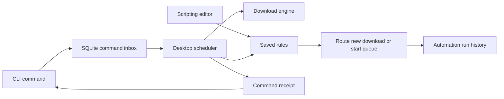

# CLI and automation

Download Engine includes `de-cli.exe` beside the desktop executable. Run it from
that application folder in PowerShell. It uses the same portable or installed
data location as the app. `DOWNLOAD_ENGINE_HOME` can select a separate absolute test folder.
No server, scripting runtime, or MCP connection is needed.

To connect an AI client instead, use `de-cli.exe mcp` and generate its setup
with `de-cli.exe mcp-config`. See [MCP integration](mcp.md) or **Help → Guide → MCP integration**.
MCP uses the same scheduler and command receipts described here.

For the application walkthrough, open **Help → Guide** or press **F1** when no
dialog is open. Its **Scripting** and **Command line** topics contain copyable
examples. The same text is shipped as [user-guide.md](user-guide.md).

## Try a real download and routing rule

This test uses W3C's small public sample PDF. It creates one queue, one rule and
one download in the profile used by this copy of the app. Existing routing rules
apply in creation order; temporarily disable an earlier rule that would also
match this URL. If `PDF test` already exists, choose a different test queue name.

1. Open PowerShell in the folder beside `de-cli.exe` and run:

   ```powershell
   .\de-cli.exe queue create "PDF test"
   ```

2. In **Scripting → New rule**, enter `Test PDF routing`. Leave **Enabled** on.
   Choose **A download is added**, hostname `www.w3.org`, extension `pdf`, and
   destination **PDF test**. Save the rule. The queue should remain paused.

3. Add the PDF without specifying a queue, so the rule chooses its destination:

   ```powershell
   .\de-cli.exe add "https://www.w3.org/WAI/ER/tests/xhtml/testfiles/resources/pdf/dummy.pdf" --name "automation-test.pdf"
   .\de-cli.exe automation history
   ```

4. Verify that **PDF test** contains the queued file and **Run history** contains
   a successful routing entry. Start the queue, wait for **Completed**, then use
   **Open folder** to inspect the PDF:

   ```powershell
   .\de-cli.exe queue start "PDF test"
   .\de-cli.exe list
   ```

5. Disable or remove `Test PDF routing` when finished. Removing a rule does not
   delete the downloaded PDF or its history.

To create that same rule entirely from PowerShell instead of step 2, run:

```powershell
.\de-cli.exe automation route "Test PDF routing" --host www.w3.org --extension pdf --queue "PDF test"
```

Use either the UI or CLI creation step once; do not create duplicate test rules.
Example URLs on `example.com` below are placeholders; replace them with real
direct file links before running those examples.

## CLI examples

```powershell
.\de-cli.exe --help
.\de-cli.exe list
.\de-cli.exe queues
.\de-cli.exe queue create "Work"
.\de-cli.exe add "https://example.com/archive.zip" --queue "Work"
.\de-cli.exe batch "C:\Downloads\urls.txt" --queue "Work"
.\de-cli.exe queue start "Work"
.\de-cli.exe queue pause "Work"
.\de-cli.exe queue limit "Work" 2
.\de-cli.exe pause DOWNLOAD_ID
.\de-cli.exe resume DOWNLOAD_ID
.\de-cli.exe status DOWNLOAD_ID
.\de-cli.exe pause-all
.\de-cli.exe retry DOWNLOAD_ID
.\de-cli.exe restart DOWNLOAD_ID
.\de-cli.exe rename DOWNLOAD_ID "Report 2026.pdf"
.\de-cli.exe move DOWNLOAD_ID "C:\Users\You\Downloads\Documents\Reports"
.\de-cli.exe remove DOWNLOAD_ID
.\de-cli.exe remove DOWNLOAD_ID --delete-file
.\de-cli.exe export "C:\Backup\downloads.json"
.\de-cli.exe export "C:\Backup\work-links.txt" --queue "Work"
```

`export FILE` is a read: it does not start the desktop. It writes the whole
download list, or one queue with `--queue`, to a new file and refuses to replace
an existing one. A `.json` name writes a Download Engine list (format
`xdownloader.download-list`, version 1: url, name, folder, queue, category and
optional sha256 per download); a `.txt` name writes one link per line for
`batch`. Logins, cookies, source pages, partial data and resume plans are never
written, and HLS/DASH/YouTube streams are left out. The result reports `path`,
`exported` and `streams_left_out`. Import lists with Tasks → Import list… in the app.

Batch files are UTF-8, one direct URL per line. Blank lines are ignored. An add or
batch accepts at most 1,000 URLs and commits all of them together. `--folder`
accepts an absolute destination; otherwise the app's download folder rules apply.
`--name` is available only for one URL. Supported inputs are direct HTTP, HTTPS,
FTP and FTPS links. For YouTube and HLS/DASH quality selection, use the app or
browser extension's existing preview workflow. The CLI does not silently pick
media quality, accept credentials, or bypass authentication prompts.

Reads do not start the desktop. Mutations start it if necessary, then its single
scheduler executes the command. New queues start paused. Starting or pausing a
queue suspends its recurring schedule, matching the desktop controls. A pause
receipt acknowledges cancellation of its worker; poll `status` until `paused`
before manipulating the file. A resume can remain queued while its queue is paused.

`retry` resumes a download that needs attention from where it stopped; `resume`
is for paused downloads. `restart` discards what was downloaded and starts over.
`rename` and `move` work on finished downloads only: the file is renamed in its
folder or moved into another folder and the download record follows it. Neither
ever replaces an existing file. `remove` takes a download off the list and keeps
its file; `--delete-file` also deletes a finished download's file. When a script
sends these commands, its own limits apply (see [Files, notifications and stored
values](#files-notifications-and-stored-values)).

Adding or resuming a file wakes an idle, unscheduled Main queue. Custom queues,
scheduled queues and a paused queue with existing waiting work keep their start
policy. In the desktop, right-click a file and choose **Start immediately** to
run it ahead of that queue without starting its other waiting files.

Commands emit one JSON document, except `--help` and `--version`. `--json` is
accepted explicitly but is already the default. Reads return `ok` and `result`;
mutations return `ok` and a `receipt` with `request_id`, `state`, `result`, `error`.
Usage/startup errors are JSON on stderr. Exit codes: **0** success, **1** rejection,
failure or cancellation, **2** an in-progress/interrupted command whose outcome
needs inspection. Always check the exit code before consuming results.

```powershell
$response = .\de-cli.exe add "https://example.com/file.zip" --queue Work | ConvertFrom-Json
if ($LASTEXITCODE -ne 0) { throw "Download command failed" }
$downloadId = $response.receipt.result[0].id
.\de-cli.exe status $downloadId | ConvertFrom-Json
```

`--wait 1..120` controls how long the CLI waits (default 15 seconds). Commands not
claimed within 30 seconds expire. On a wait timeout the CLI cancels a still-pending
command; a command already executing cannot be undone. Inspect it with
`request REQUEST_ID`. `cancel REQUEST_ID` only cancels pending commands; its
returned state tells you whether it was cancelled or had already started.
Interrupting the CLI itself does not cancel a submitted command.

For retryable scripts, supply a UUID using `--request-id UUID`. Resubmitting the
same command and ID returns its existing receipt; a different command with that
ID is rejected. The most recent 1,000 receipts are retained, so keep your own
script records for longer retention. After an app crash, a command that was
executing is marked `interrupted` and is **not automatically replayed**. Inspect
downloads, queues or rules before submitting a new request. `--no-start` is useful
for scripts that should only talk to an already-running app; if none is running,
the pending request is cancelled when the wait ends.

## Scripting page

Open **Scripting** in the top toolbar beside **Scheduler**, or use **Tools → Scripting**.
Choose **New rule** to build either workflow:

- **A download is added:** optionally match an exact site hostname and one file
  extension; route to a queue and optionally apply a per-download speed limit.
  Both conditions must match. Blank conditions match all downloads. Hostnames
  do not include subdomains automatically. File extensions use the initial name,
  before a server may supply a different filename. The first matching enabled
  routing rule wins, in creation order. Routing also applies to browser handoffs
  and batches and is committed before the download can start.
- **A queue completes:** when every remaining download completes successfully,
  start another queue. Empty queues, failures and individually paused downloads
  do not count as successful completion. A completion is processed once; a later
  batch can trigger the rule again. Saved checkpoints prevent a restart replay.
  Starting the destination uses the same schedule and synchronization behavior
  as its Start button. Rules that would form a queue loop are rejected.

Rules run while Download Engine is open, including in the tray. Existing queue
schedules remain on the Scheduler page. Editing or re-enabling a completion rule
starts watching from that point; it does not replay earlier completions. Disabling
or removing a rule prevents future actions and does not undo completed actions.
The first version supports 100 rules and retains the latest 500 run messages.
History is selectable text, with blue information and red errors. A missing
destination is recorded as an error; a newly added download remains in its
original queue. Edit the rule to choose another queue.

Rules are also available to scripts:

```powershell
.\de-cli.exe automation route "Work archives" --host example.com --extension zip --queue Work --speed-kib 1024
.\de-cli.exe automation chain "Continue with Work" --source main --queue Work
.\de-cli.exe automation list
.\de-cli.exe automation history
.\de-cli.exe automation disable RULE_ID
.\de-cli.exe automation enable RULE_ID
.\de-cli.exe automation remove RULE_ID
```

Rules run supported app actions only. They do not execute shell commands or
downloaded scripts. Rule history stores names and download IDs, not source URLs
or credentials. CLI request records share the app's local database and can
contain supplied URLs; avoid putting passwords or private tokens on a command
line, which can also be retained by your shell history.

## How it works internally

The desktop, native browser host and CLI resolve the same application profile.
Portable data lives beside that portable copy; installed data uses the installed
profile. `DOWNLOAD_ENGINE_HOME` overrides the profile for isolated tests. Do not change it
in the shell you use for normal downloads unless you intend to select other data.



### Commands and receipts

The CLI validates its arguments, submits a typed action and request UUID to
`control_requests`, and starts the desktop if necessary. It then waits for the
receipt. The desktop scheduler claims requests, executes them using existing
download and queue operations, and saves the result. There is no second download
engine in the CLI and no listening network service.

Read-only commands query the store directly. A mutating command returning `done`
means the requested action was accepted/executed, not that a newly added file has
finished downloading. Use `status DOWNLOAD_ID` or `list` to track transfers.

Receipt states are `pending`, `running`, `done`, `failed`, `cancelled`, `expired`
and `interrupted`. Pending requests expire after 30 seconds; a CLI wait timeout tries
to cancel only a still-pending request. A running action is not rolled back by
closing the CLI. After a crash, previously running requests become interrupted
instead of being replayed automatically. The same request UUID with different
arguments is rejected; identical requests reuse their receipt while retained.

### Routing and completion events

`automation_rules` stores both UI-created and CLI-created rules. Both use the same
validation. A new download and its routing decision are saved in one database
transaction, before a worker may start. Browser handoffs and batches use this
path too. Host matching is exact; extension matching ignores ASCII case. The
first matching enabled routing rule chooses the queue and optional speed cap.

When a job changes to completed, the store advances its queue's completion
generation. The scheduler checks that the source queue is nonempty and all its
remaining jobs completed successfully. It starts the destination and saves the
handled generation and run-history entry in the same transaction. This prevents
the same completion from starting the next queue again after a restart.

Rules are limited to 100. Run history retains 500 entries and command receipts
retain the most recent 1,000 (pending/running requests are preserved until
resolved). History records rule names, download IDs and outcomes, not source URLs
or credentials. Requests can contain supplied URLs, so the local database and
shell history should be treated as private application data.

## Custom scripts: Lua and PowerShell

Open **Scripting → Scripts → New script**, edit the built-in example, then
**Save script → Run script**. The fixed control bar also provides Stop and
Reload / discard edits. Unsaved buffers survive background refresh and navigation;
changing the selected script is disabled until you save or discard them.

New scripts use built-in **Lua 5.4**. Select **PowerShell** in the Language
picker for Windows automation. Changing language preserves custom source; only
an untouched starter example is replaced. Saved PowerShell definitions and old
run receipts retain their language. No separate Lua installation is needed.

### Start with the Lua guide

Open **Scripting → Scripts → Lua guide** or **Help → Guide → Lua scripting**
(also shipped in the packaged [user guide](user-guide.md#lua-scripting)). It starts with a read-only script:
create **Hello Lua**, leave **Language: Lua** and **Trigger: Manual only**, copy
the code into the editor, then **Save script → Run script**. In **Run logs**,
expect **Succeeded**, `Hello from Lua!`, `Trigger: manual` and the queue names.

The guide's next examples inspect downloads, add a real sample PDF to a reusable
queue, watch new completions and handle errors. **Copy script** copies just the
code. Return with the toolbar's **Scripting** button; unsaved edits are retained.
An automatic trigger needs its checkbox enabled and the script saved. Clicking
**Run script** always produces a manual event, with an empty `event.downloads`.

To work on a script in another editor, use the buttons in the editor's header.
**Open file…** copies a `.lua` or `.ps1` file into the editor and sets the
language from its extension; a new script also takes the file's name. The file
is copied once and nothing is saved until **Save script**; if the editor holds
unsaved code, Download Engine asks before replacing it. Files up to 64 KiB in UTF-8
or UTF-16 work (UTF-16 with its byte-order mark), and Windows line endings are
converted. **Save to file…** writes the editor's code to a `.lua` or `.ps1`
file; PowerShell files get a UTF-8 byte-order mark so Windows PowerShell 5.1
reads non-English text correctly. Site readers open `.lua` files only.

### Lua app API

Lua supports functions, loops, conditionals, tables, strings, maths, UTF-8 and
coroutines. `event` contains the trigger context below (JSON null becomes nil).
The `xd` API uses the same command validation and receipts as the CLI, in the
exact profile running the script. Calls return Lua tables and throw on failure;
use `pcall` if you want to handle an error. There is no shell command string.

```lua
for _, queue in ipairs(xd.queues()) do
    print(queue.name, "running:", queue.running)
end
print("Trigger:", event.trigger)
```

For a runnable download, use the guide's [sample PDF script](user-guide.md#add-a-real-download).
It reuses `Lua practice` instead of attempting to create the same queue twice.
`xd.add` returns a list: `jobs[1].id` is the first download ID. A successful script
run confirms that its commands succeeded; the transfer may still be running.
Check `xd.status(id)` or the download list for `complete` or `failed`. Existing
automation rules can route newly added files into another queue.

Download summaries expose `id`, `name`, `status`, `downloaded`, `total`, `queue`,
`directory` and `error`. Optional values become Lua `nil`; `saved_path` belongs
to completed event entries. A Windows folder can use a Lua long string such as
`[[C:\Downloads]]`. Ordinary variables are fresh on every run; use `xd.store` to keep
values between runs.

| Function | Result / purpose |
| --- | --- |
| `xd.downloads()`, `xd.status(id)` | Download summaries, or one summary. |
| `xd.add(url, options)` | List of added download summaries. Optional `queue`, `folder` (absolute path inside your download or category folders), `name` strings; unexpected options are errors. |
| `xd.queues()`, `xd.create_queue(name)` | Queue list or newly created paused queue. |
| `xd.start_queue(id_or_name)`, `xd.pause_queue(id_or_name)` | Start or pause a queue. |
| `xd.pause(id)`, `xd.resume(id)`, `xd.pause_all()` | Submit download controls. Poll status for their eventual result. |
| `xd.retry(id)`, `xd.restart(id)` | Try a download that needs attention again, or start any unfinished download over. Scripts can do this 5 times per download until it completes. |
| `xd.rename(id, name)`, `xd.move(id, folder)` | Rename or move a finished download's file. Needs **Can change downloaded files**. |
| `xd.remove(id)`, `xd.remove(id, {delete_file = true})` | Remove a download from the list, optionally deleting its finished file. Needs **Can change downloaded files**. |
| `xd.notify(title, text)` | Show a Windows notification; `text` is optional. At most 5 per run. |
| `xd.store.get(key)`, `xd.store.set(key, value)`, `xd.store.keys()` | Values this script keeps between runs. Setting `nil` removes a key. |
| `xd.sleep(milliseconds)` | Wait 0–60,000 ms; the run's timeout still applies. |
| `print(...)`, `xd.log("info", message)` | Blue output. |
| `xd.log("warning", message)`, `xd.log("error", message)` | Warning/error output. Logging an error alone does not fail the run; `error(message)` does. |
| `xd.command("queue", "limit", "main", "2")` | Advanced CLI arguments, each supplied separately. Available roots: list, status, add, pause, resume, pause-all, queues, queue, request, cancel, automation, retry, restart, rename, move, remove, notify, state. |

Lua has a 64 MiB VM memory limit and runs in a separate, owned CLI worker.
Stop, timeout and app shutdown terminate that worker even during an infinite
loop. It exposes no `io`, `os`, `package`, `require`, `debug`, file loaders or
bytecode loader. Use PowerShell when you need general file/program access.
Lua can still start downloads and change app state, so review code before running
it. These API limits are not a claim of OS-level isolation from hostile code.
The VM memory cap does not include Rust command processing or the whole process.

Lua is embedded with [mlua](https://github.com/mlua-rs/mlua); dependency and Lua
copyright notices ship in `docs/licenses/lua-automation-LICENSES`.

### Live editor assistance

The Lua and PowerShell editors check syntax automatically about 400 ms after you
pause typing. There is no Check button. Checks parse the current draft without
saving or running it; they never submit download commands. Outdated results are
discarded when you edit, switch scripts or change language. PowerShell parsing
uses Windows PowerShell 5.1 in a hidden, profile-free helper with a timeout.
If that parser is unavailable, the editor reports it instead of claiming success.

Line numbers and syntax colours help you read the code. Drag the editor's bottom
resize grip to make more room. Errors mark their line;
click an error below the editor to move to it. Lua's compiler supplies a line,
while PowerShell also supplies a column. **No syntax errors** confirms parsing
only: misspelled identifiers, incorrect arguments, permissions and network or
download failures may still cause runtime errors in **Run logs**.

Suggestions appear while you type a helper name, such as `xd.que`, or press
**Ctrl+Space**. Use **Up/Down** to choose, **Tab** or **Enter** to insert, or click
a suggestion. **Escape** dismisses suggestions first; press it again to leave
the editor. Tab still indents when the suggestion list is closed. Inserted
completions support normal Undo/Redo and keep the surrounding code intact.

Lua suggestions include the documented `xd.*` helpers, `event.*`, common standard
functions and keywords. Site readers suggest their web-reading helpers instead
of download-control functions. PowerShell suggests `Invoke-DownloadEngine`,
`$Event.*`, common commands and keywords. Identifiers already present earlier in
the buffer are also suggested. Suggestions stay out of comments and strings and
pause during input-method composition. This is built-in completion, not a full
language server or type checker; it does not inspect installed PowerShell modules.

### Files, notifications and stored values

**Adding downloads.** `xd.add` saves only inside the configured download folder,
category folders, or their subfolders. This applies with or without **Can change
downloaded files**; linked or redirected destinations and paths that escape the
configured folders are refused. Normal CLI calls outside a script can still
choose an absolute destination with `--folder`.

**Files.** `xd.rename`, `xd.move` and `xd.remove` change downloads, so a script
can use them only when **Can change downloaded files** is ticked in its settings
and the script is saved. Otherwise the call fails with an error that names the
setting. People using the CLI directly need no setting. Rename and move work on
finished downloads only and never replace an existing file. A move goes into
the download folder, a category folder, or a folder inside one; missing
folders inside them are created, and linked or redirected folders are refused.
A move to another drive copies the file, checks its size, then deletes the
original; if the original cannot be deleted, the copy is removed and the move
fails. `xd.move` waits up to 120 seconds for a large copy.

**Retries.** `xd.retry` and `xd.restart` from scripts count per download. After
5, the next call fails until the download completes or is removed; a person can
still retry it. This keeps a Download failed script from retrying forever.

**Notifications.** `xd.notify(title, text)` shows a Windows notification from
Download Engine. Titles longer than 64 characters and text longer than 256 are
shortened. The last line names the script; clicking the notification opens that
run in Run logs. Each notification is also written to the run log as
`Notification: …`, including when Preferences → Startup & tray → **Show
notifications from scripts** is off or no tray icon is available.

**Stored values.** `xd.store` keeps JSON-like values (numbers, text, booleans and
tables) for one script between runs and across restarts. A script can reach only
its own values: up to 200 keys of at most 128 characters, 16 KiB per value and
256 KiB in all. The script editor shows **Stored values** with **Show** and
**Clear**; removing the script removes them. PowerShell uses
`Invoke-DownloadEngine state get KEY`, `state set KEY JSON`, `state delete KEY` and
`state keys`. Site readers have neither file actions nor stored values.

```lua
-- Download failed: retry each file, then notify when scripts may retry no more.
for _, file in ipairs(event.downloads) do
    if pcall(xd.retry, file.id) then
        print("Retrying:", file.name)
    else
        xd.notify("Download still failing", (file.name or file.id) .. ": " .. (file.error or "no details"))
    end
end
```

```lua
-- Download completed: with Can change downloaded files on, sort PDFs into a
-- Reports folder next to where they were saved.
for _, file in ipairs(event.downloads) do
    if file.saved_path and file.name:lower():match("%.pdf$") then
        local folder = file.saved_path:match("^(.*)\\") .. "\\Reports"
        xd.move(file.id, folder)
        print("Moved", file.name, "to", folder)
    end
end
```

### Try a script with a sample event

An event script can be tried without waiting for a download to finish or fail.
Save a Download completed, Download failed or Queue completed script and choose
**Run with sample…**. Tick the finished downloads, or the downloads that need
attention, to send; a Queue completed script runs as if its queue had just
finished. The run receives the event its trigger would deliver, with
`event.sample` (`$Event.sample`) set to true, and Run logs label it **Sample**.
The CLI equivalent is `scripts sample SCRIPT_ID [DOWNLOAD_ID...]`.

Sample runs change nothing in Download Engine. Commands that would change something,
including `xd.retry`, `xd.rename`, `xd.notify` and `xd.store.set`, write a line such
as `Would retry archive.zip (sample run, nothing changed)` to the log instead.
Commands that only read, such as `xd.downloads` and `xd.store.get`, run normally.
Cancelling a real pending command is refused during a sample run; live scripts
can still cancel pending commands.
PowerShell's own commands are not simulated: `Remove-Item`, `Move-Item` and
programs a PowerShell script starts still run.

For standard Lua syntax and error handling, see the official
[Lua 5.4 reference manual](https://www.lua.org/manual/5.4/manual.html).
Download Engine exposes the app-specific API above and only the listed standard libraries.

## Site readers

A site reader is a Lua script with the **Site reader** trigger. It reads video pages
that Download Engine has no built-in reader for. Create one in **Scripting → Scripts → New
script**: keep **Language: Lua** (site readers are Lua only), choose **Trigger: Site
reader** and add the pages it covers under **Pages**.

A page pattern is `host/path`. The host may start with `*.` for every subdomain (not
the bare domain), and `*` in the path matches any characters, including `/`. A
pattern without a path covers the whole site. `https://` is removed when you add a
pattern; the scheme, `?query` and `#fragment` of a page are ignored, and pages on a
non-default port never match. A reader lists 1–20 patterns. The first enabled reader
whose pattern matches, in creation order, reads the page; clearing **Automatic trigger
enabled** turns a reader off. YouTube, Bilibili, TikTok and Twitch pages always use
the built-in readers.

Matching pages open with the reader from the extension's **Download video** button and
**Find videos on this page**, from **Add URL** and from **Tools → Preview video**. Link
downloads sent from the extension's context menu are not routed to readers. Readers
run in the same worker, history, timeout and Stop path as other scripts and start
ahead of them, with a slot reserved so busy scripts never hold them up.

### What a reader can do

`event.url` is the page. A reader has `print`, `xd.log`, `xd.sleep` and these:

| Function | Purpose |
| --- | --- |
| `xd.fetch(url, options)` | Read a page or API. Options: `method` (`"GET"` or `"POST"`), `headers` (a table), `body` (POST only, up to 1 MiB). Returns `status`, final `url`, `headers` (lower-case names) and `body` (text). HTTP error statuses are returned, not raised. |
| `xd.json(text)` | Parse JSON into Lua tables; JSON `null` becomes `nil`. |
| `xd.to_json(value)` | Encode a Lua value as JSON, for example a POST body. |
| `xd.url_encode(text)` | Percent-encode text for use in an address. |

Readers cannot see or change downloads: `xd.add`, `xd.downloads`, `xd.command` and
the other automation functions raise an error. Automation scripts, in turn, have no
`xd.fetch`.

`xd.fetch` reaches the public internet only. Every address, including each redirect,
is resolved and checked before connecting, and loopback, private, link-local and
other special-use addresses are refused. Your browser cookies and saved logins are
never sent; cookies a site sets are kept in memory for the rest of that run and sent
back only to the same origin (scheme, host and port). `Cookie`, `Host`,
`Accept-Encoding`, `Proxy-*` and other connection headers cannot be set. When a
redirect changes origin, all script-supplied headers are removed, including
Authorization and custom API-key headers. Redirects that would forward a POST
body to another origin are refused.

Readers and downloads returned by readers require **Preferences → Connection → Proxy →
Direct connection**. System and custom proxy routes are refused because a proxy
can resolve a hostname to a different address from the one the app checked. There
is no automatic direct fallback. This public-only restriction follows returned
files and streams through quality selection, redirects, segments and saved
downloads, including after pause or restart. Ordinary manually added downloads
and built-in site readers retain their existing proxy behavior. Re-add downloads
queued by a custom reader before 1.21.2 to apply the saved restriction: older
records did not distinguish reader results from ordinary browser downloads.
Limits: 50
requests per run (redirects count), 5 redirects per request, no redirect from HTTPS to
HTTP, 30 seconds and 8 MiB per reply, 32 headers. These are application-level limits,
not operating-system isolation.

### What a reader returns

End the script with `return { title = …, items = { … } }`:

| Field | Meaning |
| --- | --- |
| `title` | Optional page title; the page's host is used without one. |
| `items` | Up to 1,000 entries, each with `kind` (`"hls"`, `"dash"` or `"file"`), `url`, and optional `label`, `filename` and `size` (bytes). `.m3u8` and `.mpd` addresses must use `"hls"` or `"dash"`. |

One stream and nothing else opens the quality choice directly. Otherwise the items open
in the **Video downloads** list, where files are added and streams get **Choose
quality**. The page's origin is sent as the Referer for every download from a reader.
Saved stream links are not re-read on resume; if a link expires, open the page again.

If a reader fails on a page that the browser sent with its own findings, those
findings are shown instead, with the reader's error at the top.

### Testing

**Test on URL** (or the **Test** button) runs the saved reader on a page and lists
what it returned, without downloading. Its log, including `print` output and errors,
appears in **Run logs**. Save changes before testing.

### Optional PowerShell

The editor is ordinary PowerShell 5.1, with variables, functions, loops and
conditionals. It runs under your Windows account, with your file and program
access. Only run scripts you trust. No external interpreter or package is installed.
Scripts start without profiles, use UTF-8 source/output and a non-interactive
console, and work in this profile's downloads folder. The process-only execution
policy does not change your saved Windows policy; enterprise policy can still
prevent execution, in which case the run fails visibly.

### App commands and event context

`Invoke-DownloadEngine` calls the sibling `de-cli.exe`, checks its exit code,
parses JSON and returns `result` or `receipt.result` as PowerShell objects.
The helper and direct CLI children use the desktop's exact data/download paths
and never auto-launch another app. `$DownloadEngine` contains the CLI executable
path. The helper accepts the command arguments from the CLI reference above.
Scripts written before 2.0 keep working: `Invoke-XDownloader` and `$XDownloader`
remain available as the same helper and path.

```powershell
$queues = Invoke-DownloadEngine queues
foreach ($queue in $queues) {
    Write-Output ("Queue: {0} | running: {1}" -f $queue.name, $queue.running)
}
Write-Output ("Trigger: {0}" -f $Event.trigger)
```

The saved `event` (Lua) or `$Event` (PowerShell) input describes this run:

| Trigger | Event fields and behaviour |
| --- | --- |
| Manual only | `trigger = manual`, empty `downloads`; Run works with automatic triggers off. |
| App startup | `trigger = startup`, empty `downloads`; once on the next launch, then each launch while enabled. Saving it in an open app does not fire it immediately. |
| Every interval | `trigger = interval`, empty `downloads`; 1–10,080 minutes from save. Missed intervals while busy coalesce into one run; missed intervals while closed are skipped. |
| Download completed | `trigger = download_completed`, `queue` filter or null, and up to 100 `downloads` with `id`, `queue`, `name`, `saved_path`. Events wait while the script is busy and are delivered in successive batches. Removed records can have null name/path. |
| Download failed | `trigger = download_failed`, `queue` filter or null, and up to 100 `downloads` with `id`, `queue`, `name`, `error` and `attempts` (how many times Download Engine tried). Fires when a download reaches Needs attention after its automatic retries; temporary errors that are retried automatically do not count. The address is not included. |
| Queue completed | `trigger = queue_completed`, `queue` ID, empty `downloads`. Runs after all remaining files in a nonempty queue complete. Use `Invoke-DownloadEngine list` and filter by queue for its complete file list. |

Automatic triggers are off on new scripts. Choose a trigger, enable it and save.
They require the app open or in the tray. Saving/re-enabling resets the event
checkpoint and interval; prior completions do not replay. Completion triggers
observe transitions into Completed, including repeat downloads. Queue completion
requires a new completion event and all remaining jobs complete; empty queues
or queues with failed or paused downloads do not qualify, and a failure never
counts as a completion. Up to 10,000 download events are retained;
if a busy script falls behind this bound, its next event has `events_expired=true`
and its log warns that older events were dropped. This is not an exactly-once
external side-effect system: a crash may interrupt actions already in progress.

```powershell
# Select Download completed, enable its trigger, then save.
foreach ($file in $Event.downloads) {
    if ($file.saved_path -and (Test-Path -LiteralPath $file.saved_path)) {
        $checksum = Get-FileHash -LiteralPath $file.saved_path -Algorithm SHA256
        Write-Output ("{0}: {1}" -f $file.name, $checksum.Hash)
    } else {
        Write-Warning ("File was moved or removed: {0}" -f $file.id)
    }
}
```

### Runs, Stop and retained logs

Runs snapshot the saved language, code, revision, timeout and event. Editing does not
change active runs. One instance per script may be queued/running; four scripts
can execute concurrently, with the remainder waiting in order. Stop before
removing an active script. Disabling a trigger prevents future automatic runs;
it does not cancel an already accepted run. Explicit Run remains available.

Stop cancels queued runs or terminates the running script process and its
child processes. The timeout is 1–3,600 seconds, measured from process start.
App shutdown or a crash also terminates owned processes. App actions already
submitted, including downloads, are independent and may still finish; stopping
a script does not undo them. Scripts that control unrelated existing programs
must handle their own effects.

Run logs are selectable text with Copy log and a run selector. The viewer follows
the newest run until you select an older one; Latest run resumes following.
All scripts shows history even after a script definition is removed. Output
appears during execution, with blue info, red errors and light red warnings.
Run state and exit code remain visible even when a script emits no output.
Thrown errors, syntax errors and a nonzero final exit code fail the run.
Failures do not automatically retry.

There are at most 50 saved scripts (64 KiB UTF-8 source each), 100 finished runs
plus queued/running runs, and 128 KiB output per run. Excess output is drained
and discarded with a truncation warning, so a full pipe cannot freeze the child.
Definitions and run logs live in `data/queue.sqlite3`. Do not print secrets you
do not want retained. Temporary source/event files are removed after execution
and recovered on restart. Interrupted work is recorded as `interrupted` and
never replayed automatically. A startup trigger creates a separate new run on
each launch; write startup actions to tolerate repetition.

### Manage scripts from the CLI

```powershell
.\de-cli.exe scripts list
.\de-cli.exe scripts show SCRIPT_ID
.\de-cli.exe scripts run SCRIPT_ID
.\de-cli.exe scripts sample SCRIPT_ID DOWNLOAD_ID
.\de-cli.exe scripts stop RUN_ID
.\de-cli.exe scripts runs SCRIPT_ID
.\de-cli.exe scripts logs RUN_ID
.\de-cli.exe scripts disable SCRIPT_ID
.\de-cli.exe scripts enable SCRIPT_ID
.\de-cli.exe scripts remove SCRIPT_ID
.\de-cli.exe scripts state SCRIPT_ID
.\de-cli.exe scripts state SCRIPT_ID clear
```

`scripts run` returns a queued run receipt, not its eventual execution result.
Poll `scripts runs SCRIPT_ID` until the returned run is terminal. Reusing the same
`--request-id UUID` is idempotent while its receipt is retained.

`scripts save FILE.json` accepts the entire definition. New definitions need a
new UUID and `revision: 0`; edits must send the revision returned by show/save.
Stale revisions are rejected without overwriting other edits. For example:

```powershell
$definition = @{
    id = [guid]::NewGuid().ToString()
    revision = 0
    name = 'List queues'
    language = 'lua'
    body = 'for _, q in ipairs(xd.queues()) do print(q.name, q.running) end'
    enabled = $false
    trigger = @{ kind = 'manual' }
    timeout_seconds = 30
}
$definition | ConvertTo-Json -Depth 5 | Set-Content -Encoding UTF8 script.json
.\de-cli.exe scripts save script.json
```

The trigger JSON `kind` values are `manual`, `startup`, `interval` (with `minutes`),
`download_completed` and `download_failed` (each with nullable `queue`) and
`queue_completed` (with a queue ID). Add `change_files = $true` to allow file
actions. Use IDs from `queues`, not names, inside a saved script definition.
`language` is `lua` or `power_shell`. Always specify it in new JSON definitions;
omitting it means PowerShell for compatibility with older saved scripts.

PowerShell invocation and stream behaviour follow Microsoft's
[powershell.exe reference](https://learn.microsoft.com/en-us/powershell/module/microsoft.powershell.core/about/about_powershell_exe?view=powershell-5.1)
and [redirection reference](https://learn.microsoft.com/en-us/powershell/module/microsoft.powershell.core/about/about_Redirection).

### Source and verification

- `src/bin/de-cli.rs`: argument parsing, JSON output, waits and exit codes.
- `src/control.rs`: durable command inbox, receipts and request identity.
- `src/scheduler/runtime.rs`: command execution and automation scheduling.
- `src/automation.rs`: validation, routing, completion checkpoints and history.
- `src/desktop/automation.rs`: rule editor, enable switches and run history.
- `src/script_automation/`: definitions, trigger checkpoints, bounded output and process ownership.
- `src/desktop/scripts.rs`: script editor, execution controls and run logs.
- `src/desktop/guide.rs`: offline Help page compiled from `docs/user-guide.md`.

`scripts/cli_automation_smoke.cjs` runs real packaged CLI/desktop processes with
an isolated profile and a loopback HTTP server. It checks cold startup, timeout
cancellation, atomic batch validation, duplicate request IDs, routing, speed
limits, queue chaining, persisted history and actual pause/resume with byte hashes.
It does not change the normal profile or require a public download server.

The desktop tests exercise rule editing and the Help menu with actual egui input.
`scripts/native_ui_smoke.cjs --guide` captures the native Guide in both themes at
minimum and larger window sizes, using isolated paused data. Live public download
checks are reported separately from those repeatable local fixtures.

`scripts/script_automation_smoke.cjs [BINARY_FOLDER]` runs the real CLI, desktop
and both built-in Lua and Windows PowerShell in an isolated profile with loopback downloads. It checks
CLI-driven downloads and exact hashes, completion/startup/a real one-minute
trigger, failed commands, Stop/timeout/crash child-process cleanup, bounded
Unicode output, preserved nonzero exit codes, history and restart recovery.
`node scripts/script_automation_smoke.cjs dist/IDM-EX-UnsignedDev --guide-only`
executes the five Lua examples directly from the Guide against an isolated app
profile. Only the sample PDF URL is replaced with a loopback fixture. It verifies
manual logs, handled errors, queue reuse, exact downloaded bytes and completion
events without modifying the user's downloads or contacting the public sample host.

`scripts/native_ui_smoke.cjs --scripts` captures the editor and logs in both
themes, including minimum-window, empty and error states. Rust tests cover
validation, revisions, trigger state, coalescing, retention and widget input.
