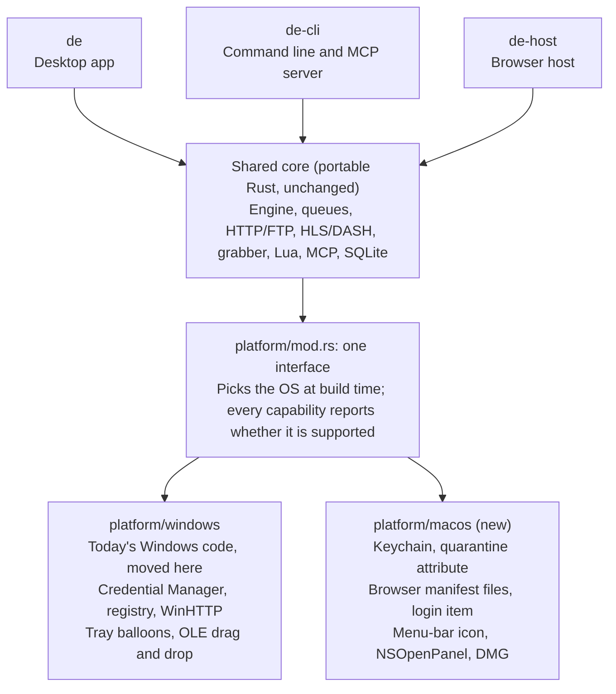

# macOS port plan

Plan as of 2026-10-22, written against Download Engine 2.0.0 for Windows. No macOS
code exists yet; this is a proposal to review, not committed work.

## Summary

A macOS version of Download Engine is possible without owning a Mac. GitHub Actions
macOS runners can build, test, sign and screenshot the app; a few hours on a rented
Mac or a tester's Mac covers the hands-on checks before each Mac release.

- **First Mac release** (phases 0 to 3): about 6 to 8 weeks of work.
- **Matching the Windows feature set** (phase 4 too): about 9 to 12 weeks.
- **Starting point:** Download Engine 2.0.0 for Windows; no macOS code exists yet.

Recommended start when going ahead: Phase 0 on Windows (no Mac needed, no change for
Windows users), plus one macOS CI run that only tries to build the app and reports
what breaks.

## Where the code stands

Most of the app is already portable Rust; the work is in about 25 Windows-only
modules. The code base has about 88,000 lines of Rust in 198 files, with 168
Windows-only checks spread across those modules. Some modules (title bar, power
options, tray notifications) have no non-Windows version at all, so the app does not
compile for macOS today.

- **Portable already:** download engine, queues, HTTP/FTP, HLS/DASH, website
  grabber, Lua scripting, MCP, the CLI, SQLite storage and the egui interface
  (eframe/winit, reqwest, tokio, rusqlite, mlua).
- **Mac building blocks already in Cargo.lock** as indirect dependencies:
  security-framework 3.7 (Keychain) and objc2 0.5 with objc2-app-kit and
  objc2-foundation 0.2 (AppKit). Any genuinely new crate still needs approval first.

| Area | Windows today | macOS replacement | Difficulty |
| --- | --- | --- | --- |
| Data folders | `%LOCALAPPDATA%`, installer mutex | `~/Library/Application Support/Download Engine`, file lock | Easy |
| Saved site passwords, MCP token | Credential Manager, DPAPI | Keychain | Easy |
| Downloaded-from-internet marking | `Zone.Identifier` | `com.apple.quarantine` attribute | Easy |
| PowerShell scripts | Built-in PowerShell | Only if the user installs `pwsh`; Lua works everywhere | Easy |
| Browser connection | Registry key and manifest | Manifest files in each browser's `NativeMessagingHosts` folder; extension ID computed differently | Medium |
| Launching the app and helpers | `CreateProcess`, job objects | Detached process, process groups | Medium |
| Start at login | Run key | Login item (`SMAppService`, macOS 13+) | Medium |
| Tray and notifications | `Shell_NotifyIcon` balloons | Menu-bar icon, system notifications (needs a signed app bundle) | Medium |
| Folder picker, power options, title bar | `IFileDialog`, shutdown or sleep, dark title bar | `NSOpenPanel`, sleep prevention plus `pmset` or `osascript`, system appearance | Medium |
| Fonts for 19 languages | Segoe UI, YaHei and others from `C:\Windows\Fonts` | System fonts found through CoreText | Medium |
| App menu and shortcuts | In-window menus, Ctrl | Standard Mac menu (About, Settings Cmd+comma, Quit Cmd+Q), Cmd shortcuts | Medium |
| Clipboard link offers | Clipboard listener window | Polling the clipboard for changes | Medium |
| Antivirus scanning | Defender, Malwarebytes, Kaspersky, Bitdefender, ClamAV | ClamAV, custom scanners, maybe the Defender for Endpoint CLI | Medium |
| Bundled FFmpeg | Pinned Windows build with security patches | Separate pinned arm64 build from the same sources and patches | Medium |
| Installer | Inno Setup | `.app` bundle in a DMG; no portable mode | Medium |
| Floating drop box, dragged links | OLE drag and drop | Custom native drop target | Hard |
| NTLM/Kerberos sign-in for sites and proxies | WinHTTP | Not in the first Mac release; later through Apple's networking | Hard |

## Platform layer design

All Windows and macOS differences move into one module, so the rest of the code never
checks which system it runs on.

The three programs share one core; the core asks the platform interface for anything
OS-specific, and the build picks the Windows or macOS side. Browser-facing IDs
(`com.xetro.downloadengine`, `download-engine@xetro`) stay the same on both systems.

**Shared capabilities** (desktop app, CLI and browser host): paths and opening files
or folders, password storage and protected data, the downloaded-from-internet marking,
launching and cleaning up processes, browser registration, start at login, system
language detection, NTLM/Kerberos sign-in, the antivirus scanner list and the script
runtime list.

**Desktop-only capabilities:** tray or menu-bar icon, notifications, power options,
folder picker, window appearance, fonts, clipboard watching, drop targets, app menu
and keyboard shortcuts.

**Rules:**

1. Platform checks exist only in `platform/mod.rs`, which selects the implementation.
2. Every capability reports whether it is supported. The app hides a feature the
   system lacks instead of showing it broken, so a first Mac release can ship with
   gaps.
3. Browser-facing IDs stay identical on both systems, so one extension build works
   everywhere.

## Phases

Phases 0 to 3 lead to the first Mac release, 2.1.0; only Phase 0 can be done without
a Mac. Phase 4 is optional and follows that release.

| Phase | Scope | Done when | Needs a Mac | Rough effort |
| --- | --- | --- | --- | --- |
| 0 - Groundwork | Move Windows code into `platform/windows`; add the supported flags; make text that names Windows things (Start menu, Explorer, Ctrl) platform-aware | All Windows tests and smoke tests pass unchanged | No | 1 to 1.5 weeks |
| 1 - Core on macOS | Build the CLI and browser host for Apple Silicon; paths, Keychain, quarantine marking, processes, browser manifests for Chrome, Edge, Brave and Firefox; MCP; Lua; tests on macOS CI | A link sent from the browser extension downloads on a Mac | Yes | 1.5 to 2 weeks |
| 2 - Desktop app | Fonts, app menu and Cmd shortcuts, menu-bar icon, notifications, folder picker, login item, power options, Show in Finder | The app is usable day to day on a Mac | Yes | 2.5 to 3 weeks |
| 3 - Packaging | `.app` bundle, permanent bundle ID, icon, DMG; optional signing and notarization; pinned arm64 FFmpeg; release scripts and checksums | 2.1.0 ships with a Mac DMG | Yes | 1 to 1.5 weeks |
| 4 - Match Windows | Clipboard offers, floating drop box and dragged links, NTLM/Kerberos, more antivirus scanners, Mac guide text in 19 languages, optional Intel build | Each piece ships on its own | Yes | 2 to 4 weeks |

Estimates are rough, for one developer working with Claude; how fast changes can be
tried on a Mac moves them most.

## Testing without a Mac

GitHub Actions macOS runners cover most testing; only hands-on checks need a real Mac,
a few hours per Mac release. A runner is a real macOS machine (a virtual machine on
Apple hardware) without a screen anyone can sit at. Building for macOS on a Windows
PC is not realistic: Apple's SDK license limits it to Apple hardware, and the bundled
SQLite and Lua need Apple's compiler.

| Check | GitHub Actions runner | Needs a real Mac |
| --- | --- | --- |
| Building, signing, notarizing | Yes | No |
| Automated tests (`cargo test`) | Yes | No |
| Scripted end-to-end runs: CLI and browser host download from a local test server | Yes | No |
| Screenshots of the real app in any language (the app's built-in screenshot mode) | Yes | No |
| Gatekeeper verdict on the signed app (command-line checks) | Yes | No |
| Clicking through menus, menu-bar icon, dragging links from a browser | No | Yes |
| Permission prompts (notifications, Keychain, Open Anyway) | No | Yes |
| Look and feel on a Retina display | No | Yes |

Options for the hands-on checks:

1. **Rent a cloud Mac** for a few hours or a month (for example MacinCloud or
   Scaleway), or AWS EC2 Mac (billed for at least 24 hours), used over remote
   desktop from a Windows PC.
2. **Mac-owning testers:** friends or beta users try each build and report problems.
3. **A used Apple Silicon Mac mini (M1 or M2):** the cheapest option long term.

Running macOS in a virtual machine on a Windows PC is not an option: Apple's license
only allows macOS on Apple hardware.

Prerequisites for CI: the project must be on GitHub (it is not a git repository yet).
macOS runners are free for public repositories; private repositories bill macOS
minutes at a higher rate than Windows or Linux.

## Signing and distribution

Signing is optional: unsigned Mac builds run, just with an extra approval step, the
way unsigned Windows builds show the unknown-publisher warning today. Notarization
removes that step and costs US$99 a year.

**Unsigned (not notarized) build, first launch:**

1. macOS blocks the app with a warning that Apple could not verify it is free of
   malware.
2. The user opens System Settings > Privacy & Security, clicks Open Anyway and enters
   their password.
3. The user opens the app again and confirms; after that it runs normally.

Since macOS Sequoia the old Control-click > Open shortcut no longer works. Technical
users can remove the downloaded flag in Terminal (`xattr -dr com.apple.quarantine`)
instead. Apple Silicon needs every program to carry at least a basic self-signature;
the Rust build tools add it automatically.

To check on a Mac with an unsigned build:

- Keychain may ask for permission again after each update, because saved passwords
  are tied to the app's signature.
- The browser host (`de-host`) that Chrome or Firefox starts may trigger its own
  security prompt.
- System notifications and Open at login may not work as smoothly.

**Notarized build:** an Apple Developer Program membership (US$99 a year), a
Developer ID Application certificate, the hardened runtime on all four programs
(`de`, `de-cli`, `de-host`, `ffmpeg`), notarization through Apple's notary service
and the ticket stapled to the DMG. All of it can run in GitHub Actions without a Mac.
The certificate and notary credentials stay with the owner or in CI secrets.

**Publisher name:** an individual account shows the owner's personal legal name;
showing "Xetro" needs an organization account, which requires a D-U-N-S number and
takes longer.

**Not the Mac App Store:** its sandbox blocks writing the browser connection files,
saving to any folder and launching FFmpeg. Distribute the DMG directly instead.

## Decisions before starting

Six choices shape the work; the recommended answer is in brackets.

- [ ] **Hands-on testing:** rented cloud Mac, Mac-owning testers, or a used Mac mini
  (rented Mac or testers to start)
- [ ] **GitHub repository:** public (free macOS runners) or private (billed macOS
  minutes)
- [ ] **Signing:** unsigned for testers first, or an Apple Developer account from the
  first Mac release (unsigned until Mac users grow)
- [ ] **Architecture:** Apple Silicon only, or also Intel (Apple Silicon only; Apple
  made macOS 26 the last version for Intel Macs, and GitHub's last Intel runner image
  ends August 2027)
- [ ] **Minimum macOS:** 13 Ventura or later (13, needed for the modern login-item
  API)
- [ ] **Bundle ID:** for example `com.xetro.downloadengine`; it can never change after
  the first release

Versioning: the first Mac release would be 2.1.0, a new compatible feature. Phase 0
alone changes nothing users see, so it ships inside the next Windows release without
its own version.

## Risks and out of scope

The largest risk is testing time: every Mac fix goes through a CI round of several
minutes or a remote session.

- **Graphics backend:** egui draws with OpenGL, which Apple has deprecated. It works
  on Apple Silicon today; moving to Metal (wgpu) would affect Windows too, so the
  first Mac release keeps OpenGL.
- **Fonts:** Mac system font file locations change between macOS versions; fonts must
  be found through CoreText, not fixed paths.
- **FFmpeg:** the macOS build must be reproducible and hash-pinned like the Windows
  one, with the same security patches.
- **Guides in 19 languages:** parts describe Windows steps (Start menu, Explorer,
  tray, Ctrl) and need Mac variants.
- **Unsigned-build behaviour:** Keychain, the browser host and notifications need
  checking on a real Mac.

Out of scope: the Mac App Store, Safari (it needs a separate Xcode-built extension),
iOS and Linux. The platform layer would make a later Linux version easier, and Linux
could be tested on Windows through WSL.

## Sources

Code figures come from the Download Engine 2.0.0 source on 2026-10-22; platform facts
from these pages.

- [macOS Tahoe is the last release to support Intel (Six Colors)](https://sixcolors.com/post/2025/06/macos-tahoe-is-the-last-release-to-support-intel/)
- [macOS 26 Tahoe is the end of the road for Intel Macs (PetaPixel)](https://petapixel.com/2025/06/10/macos-26-tahoe-is-the-end-of-the-road-for-intel-macs/)
- [Apple's new macOS Sequoia tightens Gatekeeper (The Hacker News)](https://thehackernews.com/2024/08/apples-new-macos-sequoia-tightens.html)
- [macOS Sequoia removes the Gatekeeper bypass shortcut (Cult of Mac)](https://www.cultofmac.com/864843/macos-sequoia-removes-handy-shortcut-bypass-gatekeeper-security/)
- [GitHub Actions macOS 14 runner image retirement](https://github.blog/changelog/2026-10-01-github-actions-macos-14-runner-image-retirement)
- [GitHub Actions macOS 13 runner image is closing down](https://github.blog/changelog/2025-09-19-github-actions-macos-13-runner-image-is-closing-down/)
- [Chrome native messaging (manifest locations)](https://developer.chrome.com/docs/extensions/mv3/nativeMessaging)
